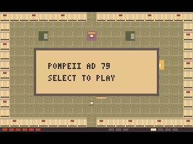
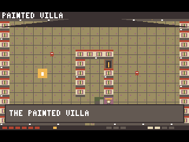
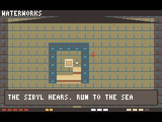
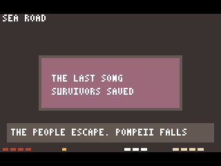
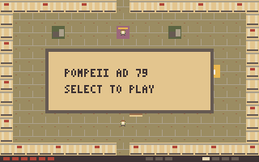
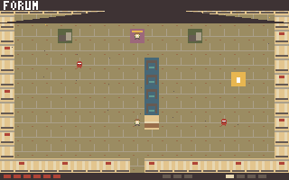
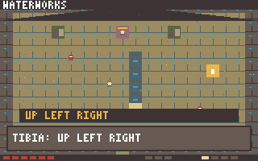
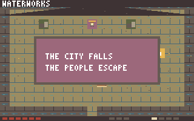

# Pompeii: The Last Song of Vesuvius

[](#build-and-test) [](#qemu) [](LICENSE) [](https://github.com/riscv-prg32/PRG32)

**An original historical-fantasy adventure for the PRG32 educational RISC-V console.** Pompeii, AD 79: apprentice instrument maker Livia searches for her missing father and helps citizens escape as Mount Vesuvius awakens. A fictional enchanted Roman *tibia* (double-pipe wind instrument) opens the way to the sea. The eruption cannot be prevented.

> **Status:** Version 1.0.0, a complete four-district game. On the PRG32 v1.8 **QEMU** firmware it boots, runs at 30 game updates per second and has been played from the title to the ending by an automated player ([evidence](docs/qemu/)). It has **not** yet been run on **ESP32-C6 hardware**. A Cartridge Store bundle is built and validated with the Store's own ingestion code, but it has not been submitted.

## Preview

[`assets/store/preview.mp4`](assets/store/preview.mp4) shows 60 seconds of the cartridge on PRG32 QEMU, with the firmware's own audio. Every frame and sound comes from the emulator; it is not concept art.

| Title (QEMU) | Painted Villa (QEMU) |
|:--:|:--:|
|  |  |
| **Waterworks, tibia played (QEMU)** | **Ending (QEMU)** |
|  |  |

Renderer captures from the host build (`make screenshots`; they call `game_render()` on constructed game states):

| Title | Forum | Tibia puzzle | Ending |
|:--:|:--:|:--:|:--:|
|  |  |  |  |

## Gameplay

- Explore four connected districts: **Forum**, **Painted Villa**, **Waterworks** and **Road to the Sea**, each with its own procedural Roman architecture and palette.
- Rescue the named citizens Marcus, Flavia, Felix and Tullia. Citizens stand their ground: walk toward one to face them, then press **B**.
- In the Villa, Waterworks and Sea Road, fallen masonry traps the citizen: strike it with **A** first.
- Looters chase you and block your way. Walking toward one turns you to face it; **A** strikes it.
- Find bronze keys; the Sea Road arch needs one.
- Stand on the Waterworks altar and press **B**, then play **UP**, **LEFT**, **RIGHT** as separate presses. **B** cancels.
- With all four citizens saved and the melody played, reach the exit beyond the Sea Road arch. Vesuvius erupts as the people escape.
- Keys, rescues, opened arches, cleared rubble and defeated looters persist when you revisit a district.

### Controls

| Control | Function |
|---|---|
| D-pad | Move; face citizens, rubble and looters; tibia notes |
| **A** | Strike |
| **B** | Rescue / play the altar / cancel the tibia |
| **START** | Start; retry after defeat; new game after the ending |
| **C** | Reserved |

On PRG32 QEMU the keyboard maps w/a/s/d to the D-pad, z (or h) to A, x (or j) to B, and Enter to START.

## Build and test

**Host tests:** C99 compiler, `make`, Python 3.

```sh
make test
```

The tests cover the game logic, the presenter, sound, the status line and regressions. They also include a **full playthrough** (`tools/autoplay.py`): a bot finishes the game from the title using button presses only, running against the host build through `ctypes`.

```sh
make screenshots
```

This writes PPM frames from the real renderer to `docs/screenshots/`. Convert them to PNG with Pillow or ImageMagick.

### PRG32 cartridges

The [PRG32 SDK](https://github.com/riscv-prg32/PRG32) is **not included**. Clone it next to this repository and install its Python requirements and Espressif's `riscv32-esp-elf` toolchain:

```sh
git clone https://github.com/riscv-prg32/PRG32.git ../PRG32
make cartridge PRG32_ROOT=../PRG32
```

`scripts/build.sh` does the following:
1. Proves the image is **position independent** (`tools/check_relocatable.py`). Portable cartridges carry no relocations, and each host loads them at a different address.
2. Builds `dist/pompeii-esp32c6.prg32` and `dist/pompeii-qemu.prg32` with `--portable --entry-prefix arelia`. The `arelia` prefix is an internal ABI name, not the title.
3. Attaches the Store metadata, icon, screenshot and colophon.
4. Writes `dist/SHA256SUMS`.

The builds are byte-reproducible. Each image is 19,238 bytes, and the cartridge needs **108,484 bytes of executable RAM**. That fits the SDK's default 128 KiB profile, but not the 32 KiB classroom or 64 KiB extended profiles. The committed cartridges were built with `riscv32-esp-elf-gcc` 14.2.0 against PRG32 v1.8.0 (`development-c6`, commit `e90c59b`).

### QEMU

```sh
make qemu PRG32_ROOT=../PRG32
make preview PRG32_ROOT=../PRG32
```

`scripts/qemu_preview.py` works on a temporary copy of the PRG32 QEMU flash image. It boots the firmware, leaving PRG32 SETUP with B if needed, and uploads the cartridge. It then plays with the same bot as the host test. The bot reads the game state from guest RAM through QMP and answers with UART key presses only. The script writes captures, `audio.wav`, `run.json`, and (for `make preview`) the 60 s `preview.mp4`. It needs the firmware in `../PRG32/build-qemu` (`python3 -m prg32 qemu build`), Espressif's `qemu-riscv32`, Pillow, numpy and ffmpeg.

Measured on 2026-11-11 (see [`docs/qemu/smoke-run.json`](docs/qemu/smoke-run.json)):
- Boot to title in 10.5 s.
- **30.1 game updates per second.**
- The ending reached after 130 taps and 29.3 s of play, with no faults in the console log.

### Cartridge Store

```sh
make store PRG32_ROOT=../PRG32
```

This packs `dist/pompeii-1.0.0-store.zip` (manifest, icon, splash, `preview.mp4`, and both cartridges). It validates the bundle with CartridgeStore's own `_prepare_bundle()` and `_bundle_preview()` when `../CartridgeStore` is available. See [docs/store_publishing.md](docs/store_publishing.md). Submitting is an authenticated, human-approved step, and no script here does it.

## Repository layout

```text
src/                 portable engine, sprites, music, presenter and PRG32 bridge
sdk/string.h         minimal freestanding C shim
tools/               host tests, autoplay bot, relocation check, Store art and bundle validation
scripts/             cartridge build, QEMU playthrough and video, Store bundle packing
metadata/            Store metadata and colophon (single source of truth)
assets/store/        icon, screenshot and 60 s preview video
docs/screenshots/    host renderer captures
docs/qemu/           PRG32 QEMU captures and run reports
dist/                cartridges, Store bundle and checksums
AGENTS.md            instructions for coding agents
STORY.md             setting, mechanics and narrative constraints
```

## For contributors and coding agents

Read [AGENTS.md](AGENTS.md) before making changes. Keep `make test` green, including the playthrough. Re-run `make qemu` after engine or bridge changes, and never claim ESP32-C6 hardware validation without a recorded run.

## Historical and IP notes

The story is original. It is inspired by ancient Roman life, Pompeii's archaeological context, and the atmosphere of Edward Bulwer-Lytton's public-domain 1834 novel *The Last Days of Pompeii*. It does **not** use Nintendo characters, visual assets, melodies, symbols or dialogue. The magic is fictional; the *tibia* is a historical Roman wind instrument. The precise date of the AD 79 eruption is intentionally not specified. See [STORY.md](STORY.md).

## License

MIT; see [LICENSE](LICENSE). The license covers this repository's original work. Third-party tools and the external PRG32 SDK keep their own licenses.

## History

See [CHANGELOG.md](CHANGELOG.md). Milestone 14 (1.0.0) is the first version run on QEMU. It fixed an unwinnable Waterworks, a cartridge that only worked when loaded at one address, wrong district banners, a missing "79" on the title, and near-silent audio.
