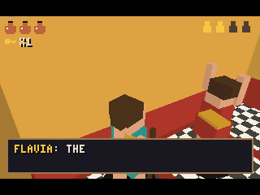
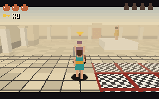
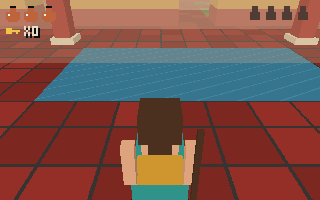
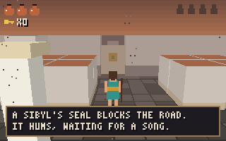

# Pompeii: The Last Song of Vesuvius

[](#build-and-test) [](#qemu) [](LICENSE) [](https://github.com/riscv-prg32/PRG32)

**An original 3D historical-fantasy action-adventure for the PRG32 educational RISC-V console.** Pompeii, AD 79: apprentice instrument maker Livia crosses four districts of the shaking city and leads its citizens to the sea as Vesuvius awakens. A fictional Sibyl's song, played on the Roman *tibia* (double pipe), sinks the stone seal on the road to the boats. The eruption cannot be prevented.

The game plays like the third-person 3D adventures of the late 1990s. A camera follows Livia, she can lock on to a target, roll out of the way, use a context button and play songs on an instrument. All of it runs on a fixed-point software 3D renderer written for a 160 MHz RV32IMC with no FPU.

> **Status:** Version 2.0.0, the 3D remake of the four-district game. On the PRG32 v1.8 **QEMU** firmware it boots, runs at 30.3 game updates per second, and an automated player has played it from the title to the ending ([evidence](docs/qemu/)). It has **not** been run on **ESP32-C6 hardware**, so the hardware frame rate is unknown. A Cartridge Store bundle has been built and validated with the Store's own ingestion code. It has not been submitted.

## Preview

[`assets/store/preview.mp4`](assets/store/preview.mp4) is 60 seconds of the cartridge on PRG32 QEMU, with the firmware's own audio. Every frame and sound comes from the emulator, not from concept art.

| Title (QEMU) | Painted Villa (QEMU) |
|:--:|:--:|
|  |  |
| **Waterworks (QEMU)** | **Ending (QEMU)** |
|  |  |

These captures come from the host build: `make screenshots` calls `game_render()` on constructed game states.

| Forum | Focus on a looter | Tibia at the altar |
|:--:|:--:|:--:|
|  |  |  |
| **Painted Villa** | **Road to the Sea** | **Ending** |
|  |  |  |

## Gameplay

- **Four 3D districts:** the **Forum**, the **Painted Villa**, the **Waterworks** and the **Road to the Sea**. Each has its own architecture (colonnades, an impluvium, channels and bridges, tombs) and palette. The sky darkens and ash falls as the eruption advances, and the plume over Vesuvius grows on the skyline.
- **Rescue** Marcus, Flavia, Felix and Tullia with **B**. In the last three districts fallen masonry traps the citizen; break it with **A** first.
- **Looters:** they wind up a club before swinging. Press **L** to focus, which brings letterbox bars and a gold marker. Strike with **A**, and dodge with **R**. Defeated looters sometimes drop an amphora that restores health.
- **Keys:** bronze keys open the gates of the Forum and the Villa.
- **The Sibyl's song:** read the Waterworks altar with **B** and the tibia rises. Play **UP LEFT RIGHT UP LEFT RIGHT** to learn the song. On the Road to the Sea, raise the tibia with **C** in front of the stone seal and play the song again to sink it.
- **Lapilli** fall on the coast road: watch for their growing shadows and roll.
- **The pier:** with everyone saved, walk onto the pier. The boats pull away and the camera turns to the mountain.
- **Persistence:** keys, gates, rubble, defeated looters, rescues and the seal stay as you left them across districts. Defeat keeps that progress and returns Livia to the district entrance.

### Controls

| Control | Function |
|---|---|
| D-pad | Move relative to the camera; circle the target while focused; tibia notes |
| **A** | Strike; advance dialogue |
| **B** | Context action: rescue, read, check (the HUD shows which); lower the tibia |
| **C** | Raise the tibia (notes: UP, LEFT, RIGHT, DOWN, A) |
| **L** | Focus on the nearest looter or object; with nothing near, recenter the camera |
| **R** | Dodge roll |
| **START** | Start; rise again after defeat; new game after the ending |

On PRG32 QEMU the keyboard maps:
- w/a/s/d to the D-pad
- z to A, x to B, k to C
- q to L, e to R
- Enter to START

## How the 3D works

- **Scale:** the scene renders at the viewport's native 320x200 in 8-bit indexed colour. The interface is laid out on a 2x2-pixel grid, so the 3x5 font stays legible.
- **Fixed point:** world coordinates are Q8 (256 per map cell) and trigonometry is Q14 from a quarter-sine table. There is no floating point and no 64-bit arithmetic: portable cartridges link without libgcc.
- **Drawing order:**
  1. a per-row sky gradient, with Vesuvius and its plume placed by azimuth;
  2. a perspective floor drawn by per-row floor casting, with texture and fog by material;
  3. walls, columns, blocks, low-poly characters and props, sorted far to near (painter's algorithm) and clipped against the view frustum in camera space.
- **Palette:** 256 colours, laid out as `material * 16 + light * 4 + fog`, with a fixed interface ramp at 240-255. Each district loads a darker variant.
- **Presenter:** a full copy of the frame would not fit in RAM, so the presenter keeps a 32-bit hash per row instead (800 bytes). It resends only the rows that changed, as runs of equal colour, and does a full resync every 300 frames.

## Build and test

**Host tests:** C99 compiler, `make`, Python 3.

```sh
make test
```

Ten C test programs cover:
- the controller contract
- dialogue, the altar and the seal
- rescue hazards
- room persistence through the real exits
- the eruption and ending
- audio phrases and music
- the presenter
- the status band
- level data invariants
- a 20,000-frame random-input smoke run, plus a renderer bounds check from many camera positions in every district

`make test` also runs a **full playthrough** with `tools/autoplay.py`. This bot finishes the game from the title with button presses only, against the host build through `ctypes`. It parses the maps from `src/world.c`, plans a path, and presses the D-pad direction that the current camera turns into the heading it wants.

```sh
make screenshots
```

This writes PPM frames from the real renderer, scaled to 320x200, to `docs/screenshots/`. Convert them to PNG with Pillow or ImageMagick.

### PRG32 cartridges

The [PRG32 SDK](https://github.com/riscv-prg32/PRG32) is **not included**. Clone it next to this repository and install its Python requirements and Espressif's `riscv32-esp-elf` toolchain:

```sh
git clone https://github.com/riscv-prg32/PRG32.git ../PRG32
make cartridge PRG32_ROOT=../PRG32
```

`scripts/build.sh` does four things:
1. It proves the image is **position independent** with `tools/check_relocatable.py`.
2. It builds `dist/pompeii-esp32c6.prg32` and `dist/pompeii-qemu.prg32` with `--portable --entry-prefix arelia`. The `arelia` prefix is an internal ABI name.
3. It attaches the Store metadata, icon, screenshot and colophon.
4. It writes `dist/SHA256SUMS`.

Each image is 46,696 bytes with its Store trailer, within the 64 KiB Store slot. The cartridge needs **96,884 bytes of executable RAM**, so it uses the SDK's default 128 KiB profile. The committed cartridges were built with `riscv32-esp-elf-gcc` 14.2.0 against PRG32 v1.8.0.

### QEMU

```sh
make qemu PRG32_ROOT=../PRG32
make preview PRG32_ROOT=../PRG32
```

`scripts/qemu_preview.py`:
1. Works on a temporary copy of the PRG32 QEMU flash image.
2. Boots the firmware, leaving PRG32 SETUP with B if needed.
3. Uploads the cartridge.
4. Plays with the same bot as the host test. The bot reads the game state from guest RAM through QMP and answers with UART key presses only. It holds directions by repeating keys inside the firmware's 120 ms hold window.

It writes captures, `audio.wav` and `run.json`; `make preview` also writes the 60 s `preview.mp4`.

Measured on 2026-11-11 (see [`docs/qemu/smoke-run.json`](docs/qemu/smoke-run.json)):

- Boot to title in 10.6 s.
- **30.3 game updates per second** with the full 3D scene (the firmware's 30 fps target), so QEMU shows no slowdown.
- The bot reached the ending after 559 inputs and 143.6 s of play, rescuing all four citizens and learning and playing the song. The console log shows no faults.
- QEMU speed says nothing about ESP32-C6 speed. A moving frame sends about 3,300 one-row runs to the display, and the hardware frame rate has not been measured.

### Cartridge Store

```sh
make store PRG32_ROOT=../PRG32
```

This packs `dist/pompeii-2.0.0-store.zip`, which holds the manifest, icon, splash, `preview.mp4` and both cartridges. When `../CartridgeStore` is available, it validates the bundle with CartridgeStore's own `_prepare_bundle()` and `_bundle_preview()`. See [docs/store_publishing.md](docs/store_publishing.md). Submitting is an authenticated, human-approved step, and no script here does it.

## Repository layout

```text
src/                 game logic, world data, 3D rasterizer, renderer, music, presenter, PRG32 bridge
sdk/string.h         minimal freestanding C shim
tools/               host tests, autoplay bot, trig table generator, relocation check, Store art and bundle validation
scripts/             cartridge build, QEMU playthrough and video, Store bundle packing
metadata/            Store metadata and colophon (single source of truth)
assets/store/        icon, screenshot and 60 s preview video
docs/screenshots/    host renderer captures
docs/qemu/           PRG32 QEMU captures and run reports
dist/                cartridges, Store bundle and checksums
AGENTS.md            instructions for coding agents
STORY.md             setting, mechanics and narrative constraints
```

## For contributors and coding agents

Read [AGENTS.md](AGENTS.md) before making changes. Keep `make test` green, including the playthrough. Re-run `make qemu` after engine or bridge changes. Never claim ESP32-C6 hardware validation without a recorded run.

## Historical and IP notes

The story is original. It draws on ancient Roman life, Pompeii's archaeological context, and the atmosphere of Edward Bulwer-Lytton's public-domain 1834 novel *The Last Days of Pompeii*. The game's structure is inspired by a genre, the third-person 3D action-adventure. It uses no characters, names, models, melodies, symbols, interface or dialogue from any existing game. The magic is fictional, while the *tibia* is a real Roman wind instrument. The game deliberately does not give a precise date for the AD 79 eruption. See [STORY.md](STORY.md).

## License

MIT; see [LICENSE](LICENSE). The license covers this repository's original work. Third-party tools and the external PRG32 SDK keep their own licenses.

## History

See [CHANGELOG.md](CHANGELOG.md). Version 2.0.0 rebuilds the game in 3D. Version 1.0.0 was the top-down game that was first run on QEMU.
